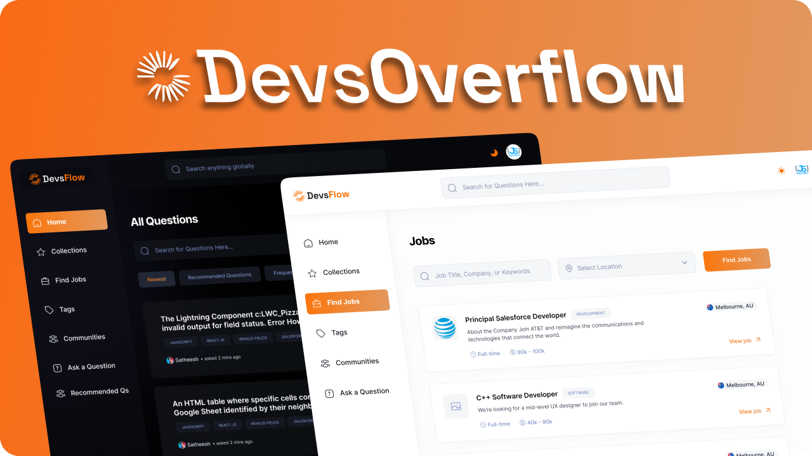

<div align="center">
  <div>
    
    
    
    
    
    
  </div>

</div>

## 📋 <a name="table">Table of Contents</a>

1. 🤖 [Introduction](#introduction)
2. ⚙️ [Tech Stack](#tech-stack)
3. 🔋 [Features](#features)


## <a name="introduction">🤖 Introduction</a>

Devs-Overflow is a modern, AI-powered Q&A platform built for developers. It combines the power of community knowledge with intelligent solutions to help developers find answers, share expertise, and grow together. Delve into the codebase to explore more.

A full-stack project, Devoverflow—a community-driven platform inspired by StackOverflow, enhanced with AI-powered answers, gamification, recommendations, and more. Using the latest features of Next.js, Here rendering strategies like SSG, ISR, SSR, PPR, Server Functions, Caching, & Revalidation to create a production-ready application.

The project uses MongoDB for a robust database layer, NextAuth (Auth.js) for versatile authentication options (Email/Password, GitHub, Google), and sleek styling with TailwindCSS and ShadCN UI. Devoverflow enables developers to ask questions, post answers, leverage AI for responses, vote, organize content, contribute, discover jobs, and explore recommended topics—all while engaging with gamified elements like badges and rewards.

<br>

<a href="https://dev-overflow-umber.vercel.app">
  <p align=center>
    
  <p>
</a>

## <a name="tech-stack">⚙️ Tech Stack</a>

- Zod
- Next.js
- NextAuth
- Open AI
- MongoDB
- ShadCN UI
- TypeScript
- TailwindCSS
- React Hook Form

## <a name="features">🔋 Features</a>

👉 **Authentication**: Secure sign-in with NextAuth, supporting Email/Password, Google, and GitHub.

👉 **Home Page**: Displays questions with filters, search, and pagination for easy navigation.

👉 **Recommendations**: Personalized suggestions on the home page.

👉 **Complex Layout**: Organized layout with popular questions and tags in view.

👉 **Question Details**: View questions with rich content, including images and code blocks.

👉 **Voting**: Upvote/downvote on questions to highlight helpful content.

👉 **View Counter**: Tracks the number of views for each question.

👉 **Bookmarking**: Save questions for quick access later.

👉 **Answer Posting**: MDX editor with light/dark modes for submitting answers.

👉 **AI Answer Generation**: Get AI-generated responses to questions.

👉 **Answer Filtering**: Sort answers by newest or most-voted, with pagination.

👉 **Answer Voting**: Upvote/downvote answers to rank quality responses.

👉 **Collections**: Organized saved questions with filters, search, and pagination.

👉 **Community**: Browse all users with search, filters, and pagination.

👉 **Profile**: View user info, badges, and engagement history with pagination.

👉 **Job Finder**: Discover jobs with filters and search, tailored to the user’s location.

👉 **Tags Page**: List of all tags with question counts, filters, and pagination.

👉 **Tag Details**: View questions by tag with search and pagination.

👉 **Ask a Question**: Simple interface for posting new questions.

👉 **Edit & Delete**: Update or remove questions and answers with validation and authorization.

👉 **Global Search**: Find content across questions, users, tags, and more.

👉 **Responsive Design**: Fully optimized for a seamless experience on desktops, tablets, and mobile devices.

👉 **High Performance**: Fast loading and smooth interactions for an efficient user experience.

and many more, including code architecture and reusability

<br>

## <a name="local-development"> 🖥️&nbsp;&nbsp; Local Development</a>

0.  **Prerequisites** <br>
    Make sure you have the following installed on your machine:

    - [Git](https://git-scm.com/)
    - [Node.js](https://nodejs.org/en) (v20+)
    - [Docker](https://www.docker.com/)
    - [pnpm](https://pnpm.io/) (Package Manager)

1.  **Clone the repository:**

    ```bash
    git clone https://github.com/yntpdotme/devs-overflow.git
    ```

2.  **Navigate to the project directory:**

    ```bash
    cd devs-overflow
    ```

3.  **Install dependencies:**

    ```bash
    pnpm install
    ```

4.  **Add Environment Variables:**

    Create `.env` file in the root folder and copy paste the content of `.env.sample`

    ```bash
    cp .env.sample .env
    ```

    Update credentials in `.env` with your credentials.

5.  **Setup Database**

    Start Mongodb with Docker

    ```bash
    docker compose up -d
    ```

6.  **Start the App:**

    ```bash
    pnpm dev
    ```

    Visit &nbsp;[http://localhost:3000](http://localhost:3000)&nbsp; to access your app.

<br>

## 🤝&nbsp;&nbsp;Contributing

Contributions are always welcome!

See [CONTRIBUTING.md](./CONTRIBUTING.md) for ways to get started.
</br></br>

## 🪪&nbsp;&nbsp; License

Devs-Overflow is open-source under the [MIT License](./LICENSE).
Feel free to learn, add upon, and share!

